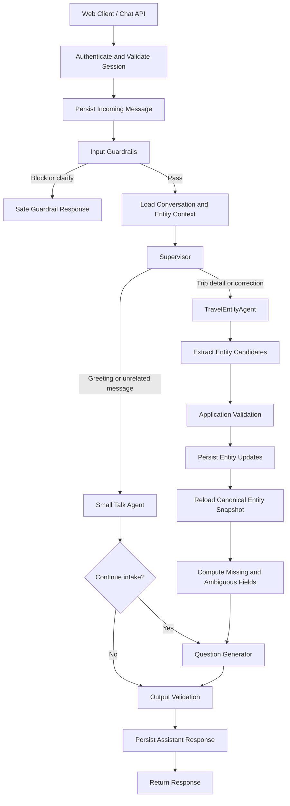

# Agentic Travel Intake Chatbot

A conversational travel-intake assistant built with **LangGraph** and **LangChain**. Its primary job is to greet a visitor, understand their trip intent, collect travel details across multiple turns, save those details for the current session, and ask the most useful next question until the required intake information is complete.

> **Project status:** Phases 1–7 of the design plan are implemented for the SQLite development setup. The PostgreSQL production configuration is planned, not yet wired (see [Persistence and databases](#persistence-and-databases)).

## Contents

- [Goals and scope](#goals-and-scope)
- [Architecture](#architecture)
- [Agents](#agents)
- [Travel entities](#travel-entities)
- [Persistence and databases](#persistence-and-databases)
- [GPT and Gemini model support](#gpt-and-gemini-model-support)
- [Project structure](#project-structure)
- [Local development setup](#local-development-setup)
- [Conversation flow example](#conversation-flow-example)
- [Security and reliability](#security-and-reliability)
- [Testing strategy](#testing-strategy)
- [Implementation roadmap](#implementation-roadmap)
- [Documentation](#documentation)

## Goals and scope

### Goals

- Greet users naturally and guide them into travel planning.
- Extract multiple travel entities from a single user message.
- Preserve trip details and corrections between turns.
- Ask targeted questions based on missing, ambiguous, or conditional entities.
- Avoid asking for information that is already known.
- Support configurable **OpenAI GPT** and **Google Gemini** models by agent role.
- Validate inputs and agent outputs, including prompt-injection attempts, before acting on them.
- Keep the design portable from SQLite in development to PostgreSQL in production.

### Out of scope for the initial intake chatbot

Flight or hotel inventory search, live pricing, reservations, payments, and booking are not included in the initial scope. The assistant must not claim it searched availability or booked anything unless those capabilities are implemented and actually invoked.

## Architecture



### Core processing rule

**Guard → route → extract → validate → save → reload → ask → validate response.**

The Question Generator must use the latest persisted entity snapshot, not just model memory or a potentially stale graph checkpoint.

## Agents

| Agent / node | Responsibility | Database access |
|---|---|---|
| Input Guardrails | Validate request size, language, session scope, and likely prompt injections before the Supervisor runs | No direct entity writes |
| Supervisor | Route a turn to an allowed specialist using structured output | None required |
| Small Talk Agent | Greet, handle brief small talk or unrelated queries, and gently redirect toward travel intake | None |
| TravelEntityAgent | Extract trip details and corrections, then request narrow typed tools to read or update entities | Through scoped repository tools only |
| Question Generator | Select the highest-value next question from the current missing/ambiguous entity list | Read-only input; no entity writes |
| Output Validation | Check the response for unsafe disclosures, schema failures, and unsupported claims | None required |

The Supervisor may choose only from explicitly allowed routes. It must not write trip entities itself. Specialist agents must not access arbitrary SQL or select another user's session. For predictable behavior, use structured outputs and bounded retries instead of unconstrained agent loops.

## Travel entities

The entity catalog should be configuration-driven and versioned. The initial recommended fields are:

| Entity | Example | Initial requirement |
|---|---|---|
| Destination | Rome, Italy | Required |
| Origin | Dallas, Texas | Required when needed by downstream planning |
| Departure date | 2027-05-10 | Required or explicitly flexible |
| Return date | 2027-05-17 | Conditional on trip type |
| Trip duration | 7 nights | Conditional / recommended |
| Trip type | Round trip | Required for date logic |
| Travelers | 2 adults, 1 child | Required |
| Budget | USD 2,500 total | Recommended |
| Date flexibility | Flexible by 2 days | Recommended |
| Transport preferences | Flight, train, rental car | Optional |
| Accommodation preferences | Hotel, room count, preferred area | Optional |
| Interests | Museums, food, outdoors | Optional |
| Special requests | Short user-provided note | Optional |

Each entity should define its type, normalizer, validation rules, required conditions, priority, dependencies, allowed statuses, and schema version. The exact required fields are a product decision.

### Entity statuses

- `known` — a validated value is available.
- `missing` — no answer has been provided.
- `ambiguous` — the user's answer needs clarification.
- `flexible` — the user has said the value can vary.
- `not_applicable` — the field does not apply to this trip.
- `declined` — the user has chosen not to provide the information.

Do not fabricate a value merely to fill a field. Intake is complete when the configured required fields satisfy their completion rules; optional fields may remain missing.

## Persistence and databases

### Environment strategy

| Environment | Application tables | LangGraph checkpointing |
|---|---|---|
| Local development and tests | SQLite, e.g. `travel_bot.db` | `langgraph-checkpoint-sqlite`; `SqliteSaver` for synchronous graphs or `AsyncSqliteSaver` for asynchronous graphs |
| Production | PostgreSQL | `langgraph-checkpoint-postgres`; `PostgresSaver` or `AsyncPostgresSaver` for asynchronous graphs |

Use SQLAlchemy behind repository interfaces for application data. This keeps SQL and database-specific behavior out of the agents and makes the production migration easier. Use the same logical data model in both environments.

SQLite and LangGraph checkpoint tables may share one local SQLite file, but the application must not query or edit LangGraph's internal checkpoint tables directly. Use the checkpointer API for graph state and application repositories for travel entities and messages.

### Application tables

The initial application schema is expected to contain:

- `travel_sessions` — session owner/tenant, status, language, schema version, timestamps, and concurrency version.
- `conversation_messages` — user and assistant messages, message IDs, timestamps, and guardrail metadata.
- `session_entities` — one canonical row per `(session_id, entity_key)`, with structured value, status, confidence, evidence, and update version.
- `entity_change_history` — immutable audit records for entity changes, including prior/new values and source message.

The **application entity tables are the source of truth for trip facts**. LangGraph checkpoints preserve graph/thread state and are not the authoritative entity database. Refresh entity state from the repository before selecting the next question.

### Development-to-production migration

- Use SQLite for local experimentation, automated tests, and debugging.
- Use Alembic or an equivalent migration process for application schema changes.
- Test repository and migration behavior on PostgreSQL before production release.
- Move application tables and LangGraph checkpoint persistence to PostgreSQL for production.
- Do not assume the SQLite checkpoint file can simply be copied to PostgreSQL. Plan a supported checkpoint migration or reconstruct state from persisted conversation history and canonical entities.

## GPT and Gemini model support

All agent model instances should be created by a shared model factory, not hard-coded in individual agent files. Use LangChain's unified `init_chat_model` interface or an equivalent provider adapter, and inject the selected model into each agent.

Configure models independently by role so that GPT and Gemini can be compared or switched without changing graph logic.

### Environment configuration

Create a local `.env` file from `.env.example` and replace the example values with model IDs supported by your provider accounts. The model IDs below are **placeholders**, not a recommendation of specific current versions.

```dotenv
# Never commit real credentials.
OPENAI_API_KEY=replace_with_openai_api_key
GOOGLE_API_KEY=replace_with_google_api_key

# Use provider-qualified model IDs supported by your installed LangChain integrations.
SUPERVISOR_MODEL=openai:<approved-gpt-model-id>
SMALL_TALK_MODEL=google_genai:<approved-gemini-model-id>
TRAVEL_ENTITY_MODEL=openai:<approved-gpt-model-id>
QUESTION_GENERATOR_MODEL=google_genai:<approved-gemini-model-id>
GUARDRAIL_CLASSIFIER_MODEL=google_genai:<approved-gemini-model-id>
```

A model role can use either provider. Choose final model IDs based on availability, structured-output and tool-calling support, evaluated quality, latency, and cost. Pin compatible dependency versions and model IDs for repeatable tests.

### Provider compatibility checks

Before assigning a model to an agent, test:

- Structured output against the relevant Pydantic/schema definitions.
- Tool calling, including malformed arguments and tool errors, for agents that use tools.
- Multilingual entity extraction and response-language consistency.
- Resistance to prompt injection when used with the full guardrail pipeline.
- Timeout, rate-limit, retry, token-limit, and invalid-output behavior.
- Extraction accuracy, repeated-question rate, completion rate, latency, and estimated cost.

Application code must validate model output even when the provider supports structured output. Keep API keys in environment variables during local development and in a secret manager in production. Never log credentials.

## Project structure

```text
src/travel_bot/
├── agents/            supervisor, small_talk, travel_entity, question_generator
├── api/               FastAPI app + minimal web chat page (static/index.html)
├── database/          SQLAlchemy models (portable SQLite/PostgreSQL) + async engine
├── entities/          versioned catalog (catalog_v1.json), normalizers, merge/correction
│                      rules (resolution.py), requirement rules, rendering
├── graph/             LangGraph state, workflow, checkpointer selection
├── guardrails/        deterministic + optional LLM input checks, output validation
├── models/            role -> model config, GPT/Gemini factory, structured-output calls
├── prompts/           versioned prompts per role
├── repositories/      session / message / entity repositories
├── services/          entity service (validated, idempotent writes), question planner,
│                      chat service (auth, idempotency, rate limit, graph invocation)
├── tools/             session-bound entity tools (no session_id in any tool schema)
├── bootstrap.py       composition root
└── cli.py             terminal chat
migrations/            Alembic migrations for the application tables
evals/                 golden conversation set
scripts/run_eval.py    evaluate the configured real models against the golden set
tests/                 unit + end-to-end scenario tests (scripted fake models, no API keys)
```

## Local development setup

### Prerequisites

- Python 3.13 and [uv](https://docs.astral.sh/uv/).
- An API key for at least one provider: OpenAI or Google Gemini.

### Install and configure

```bash
uv sync                      # creates .venv from pyproject.toml + uv.lock
cp .env.example .env         # PowerShell: Copy-Item .env.example .env
```

Edit `.env`: set `OPENAI_API_KEY` (and/or `GOOGLE_API_KEY`) and choose a provider-qualified model per role, e.g. `TRAVEL_ENTITY_MODEL=openai:gpt-5.5` or `google_genai:gemini-3.1-pro-preview`. Only providers referenced by a `*_MODEL` setting need a key. Startup fails with a clear message if one is missing.

### Run

```bash
uv run travel-bot            # terminal chat (/entities shows saved details, --debug shows metadata)
uv run travel-bot-api        # http://127.0.0.1:8000 (web chat) and /docs (API)
```

SQLite files `travel_bot.db` (application data) and `travel_bot_checkpoints.db` (LangGraph checkpoints) are created on first run (`DB_AUTO_CREATE=true`). To use migrations instead, run `uv run alembic upgrade head`.

### HTTP API

| Method | Path | Notes |
|---|---|---|
| `POST` | `/sessions` | Returns `session_id` and a secret `session_token`. |
| `POST` | `/sessions/{id}/messages` | Body `{message_id, content}`; header `X-Session-Token`. `message_id` is the idempotency key. |
| `GET` | `/sessions/{id}/entities` | Canonical entity snapshot + missing/ambiguous fields. |
| `GET` | `/sessions/{id}/messages` | Stored (redacted) conversation. |

### Tests and evaluation

```bash
uv run pytest                          # no API keys needed
uv run python scripts/run_eval.py      # runs the golden set against the models in .env
```

Run the evaluation for every model, provider, or prompt change, and for each role you switch between GPT and Gemini.

## Conversation flow example

**User:** Hi!

**Assistant:** Hi! I’d be happy to help plan your trip. Where are you thinking of going?

**User:** Rome next May, leaving from Dallas. We are two adults and want to stay about a week.

The system should extract and persist, where supported:

- Destination: Rome
- Origin: Dallas
- Travel month: May (ask for a year or normalize it only with a reliable reference date and clear product rules)
- Travelers: 2 adults
- Duration: about one week

The Question Generator then checks the refreshed canonical entity state and asks only for the highest-priority unresolved information—for example, which dates in May the user prefers. It must not ask again for the destination, origin, traveler count, or duration.

## Security and reliability

- Authenticate and authorize the session outside the LLM; do not let a model choose another user's `session_id` or tenant.
- Run request validation, language detection, and prompt-injection screening before the Supervisor.
- Treat user text and quoted instructions as untrusted data, not as instructions that can override application policy.
- Use deterministic validation and allow-listed routes alongside semantic guardrail checks.
- Give agents narrow typed tools rather than direct SQL access.
- Validate and transactionally persist entity updates; use idempotency keys and version checks to prevent duplicate or stale writes.
- Do not claim data was saved unless the persistence layer confirms success.
- Do not collect unnecessary sensitive data such as payment-card details or passport numbers for travel-intake purposes.
- Bound model/tool retries and agent calls to prevent loops.
- Redact personal data from telemetry where possible and define message retention rules.

## Testing strategy

Build automated tests for:

- Extracting multiple entities from one message.
- Corrections, conflicting values, ambiguous dates, flexibility, and declined fields.
- Greetings that successfully start intake.
- Small talk and unrelated questions that redirect appropriately.
- No repeated questions for known entities.
- Entity persistence, idempotency, audit history, and optimistic concurrency.
- Thread continuity across turns and application restarts.
- Prompt-injection attempts and session-isolation boundaries.
- Invalid model output, model timeouts, tool errors, rate limits, and database failures.
- GPT/Gemini behavior against the same golden conversation dataset.
- SQLite development behavior and PostgreSQL migration/production behavior.

Track entity precision/recall, required-field completion rate, repeated-question rate, guardrail false positives/negatives, latency, token use, and cost where available.

## Implementation roadmap

1. Define the entity catalog, schemas, and completion rules.
2. Implement SQLite-backed repositories and deterministic validation tools.
3. Build and evaluate structured entity extraction.
4. Orchestrate the graph with SQLite checkpointing and stable session/thread IDs.
5. Add guardrails and bounded Supervisor routing.
6. Add question prioritization and intake completion behavior.
7. Run end-to-end/security/failure tests, then validate PostgreSQL and production checkpointing.

## Documentation

- [LangGraph persistence](https://docs.langchain.com/oss/python/langgraph/persistence)
- [LangGraph checkpoints and thread IDs](https://docs.langchain.com/oss/python/langgraph/checkpoints)
- [LangGraph SQLite checkpointer](https://reference.langchain.com/python/langgraph.checkpoint.sqlite)
- [LangGraph PostgreSQL checkpointer](https://reference.langchain.com/python/langgraph.checkpoint.postgres)
- [LangChain `init_chat_model`](https://reference.langchain.com/python/langchain/chat_models/base/init_chat_model)
- [LangChain OpenAI integration](https://reference.langchain.com/python/langchain-openai)
- [LangChain Google Gen AI integration](https://reference.langchain.com/python/langchain-google-genai)
- [LangChain guardrails](https://docs.langchain.com/oss/python/langchain/guardrails)
- [LangChain agents](https://docs.langchain.com/oss/python/langchain/agents)
- [LangChain multi-agent patterns](https://docs.langchain.com/oss/python/langchain/multi-agent)

---

Contributions should preserve the core separation of responsibilities: the Supervisor routes, the TravelEntityAgent extracts, application repositories validate and persist entity state, and the Question Generator selects the next question from the latest canonical state.
