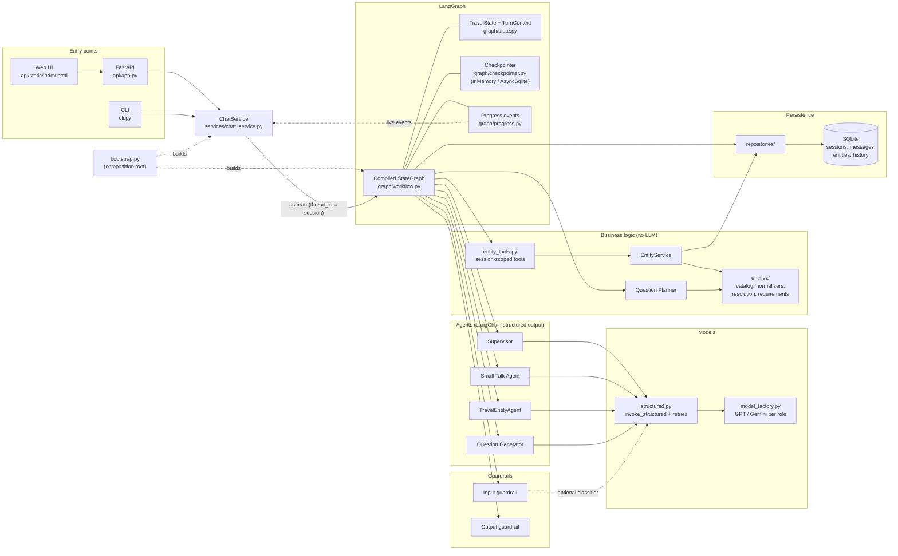
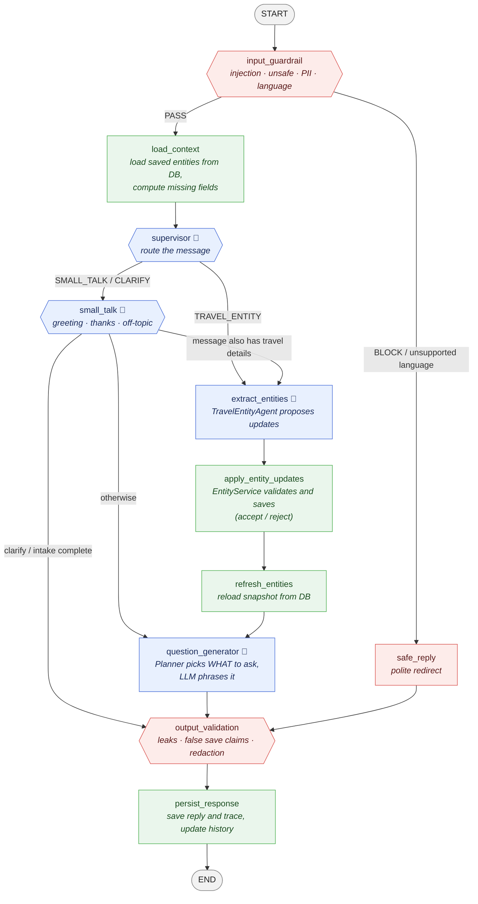

# Architecture Overview

This is an agentic travel intake chatbot. It talks with a traveller, pulls out trip details (destination, dates, party size and so on), saves them, and works out which question to ask next.

**Stack**

| Concern | Framework |
|---|---|
| Workflow / orchestration | **LangGraph** (`StateGraph`, conditional edges, checkpointer, custom stream) |
| LLM calls | **LangChain** (`init_chat_model`, `with_structured_output`, `StructuredTool`), with GPT or Gemini models |
| HTTP API + web UI | **FastAPI** + Uvicorn |
| Persistence | **SQLAlchemy** (async) + **Alembic** on SQLite |
| Validation / settings | **Pydantic**, pydantic-settings |
| Language detection | langdetect |
| Retries | tenacity |

---

## 1. System wiring

How a request reaches the graph, and which modules each node depends on.



---

## 2. LangGraph turn workflow

Each user message runs through this graph once. The graph never loops, and a turn is capped at **6 model calls**.



**Legend:** 🤖 / blue = LLM agent · red = guardrail · green = database / deterministic logic

### What each node does

| Node | Module used | Purpose |
|---|---|---|
| `input_guardrail` | `guardrails/input_guardrails.py` | Deterministic checks (prompt injection, unsafe content, card / passport / SSN numbers, language detection), plus an optional LLM classifier |
| `safe_reply` | `guardrails/input_guardrails.py` | Writes a safe redirect for blocked or unsupported messages |
| `load_context` | `services/entity_service.py`, `entities/requirements.py` | Loads the saved trip details and lists the missing, recommended and ambiguous fields |
| `supervisor` | `agents/supervisor.py` | LLM router that returns an allow-listed route; the graph's edges do the actual routing |
| `small_talk` | `agents/small_talk.py` | Social replies that steer the user back to trip planning |
| `extract_entities` | `agents/travel_entity.py` | Proposes candidate entity updates; it never writes |
| `apply_entity_updates` | `tools/entity_tools.py` → `services/entity_service.py` | Validates, normalises, merges and saves updates (idempotent, with a version check) |
| `refresh_entities` | `services/entity_service.py` | Reloads the snapshot so later steps work from the saved data |
| `question_generator` | `services/question_planner.py` + `agents/question_generator.py` | Rules pick the next question; the LLM only writes the wording |
| `output_validation` | `guardrails/output_guardrails.py` | Blocks leaked secrets or internals, unsupported claims, and claims to have saved data when the save failed |
| `persist_response` | `repositories/message_repository.py`, `session_repository.py` | Saves the reply and the turn trace, and updates question history |

---

## 3. Module map

```
src/travel_bot/
├── api/            FastAPI app + static web UI (streaming chat endpoint)
├── cli.py          Terminal chat client
├── bootstrap.py    Composition root: settings → DB → models → agents → graph → ChatService
├── config.py       Settings (pydantic-settings, .env)
│
├── graph/          LangGraph: workflow, state, checkpointer, live progress events
├── agents/         Supervisor, Small Talk, TravelEntityAgent, Question Generator
├── prompts/        System prompts per agent
├── models/         Per-role model factory (GPT / Gemini) + structured-output helper
│
├── services/       ChatService (turn handling), EntityService (only writer), QuestionPlanner
├── entities/       Entity catalog (JSON), normalisers, merge/resolution rules, requirements
├── tools/          Session-scoped LangChain tools around EntityService
├── guardrails/     Input and output guardrails + regex patterns
│
├── database/       SQLAlchemy engine + tables
├── repositories/   Data access (sessions, messages, entities)
└── schemas/        Pydantic models for agents, entities, API, enums
```

Supporting folders:

- `migrations/`: Alembic schema migrations
- `tests/`: pytest suite (fake models, conversations, guardrails, resolution, API)
- `evals/` + `scripts/run_eval.py`: golden conversation evaluations

---

## 4. Key design principles

1. **LLMs propose, code decides.** Agents only route, extract and write wording. Saving data and choosing the next question are deterministic code.
2. **Allow-listed routing.** The supervisor returns a structured decision, and LangGraph's conditional edges perform the route, so the model cannot invoke arbitrary tools or agents.
3. **The database is the source of truth.** The checkpointer keeps conversation state, but entity data is reloaded from the DB every turn.
4. **Session isolation.** Session IDs come from the authenticated request (`TurnContext`) and are never exposed to the model. Tools are bound to a single session.
5. **Bounded cost.** The graph never loops and each turn is capped at 6 model calls; when the budget runs out, the bot falls back to template text.
6. **Layered guardrails.** Input checks, tool-level validation and output checks each guard independently.
